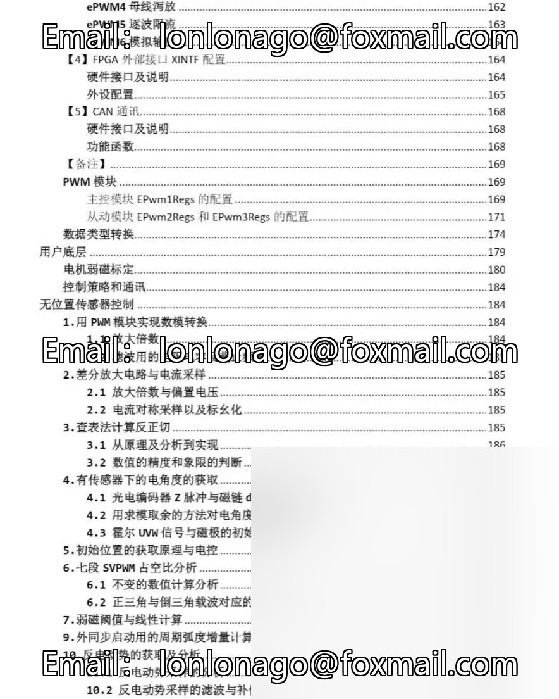
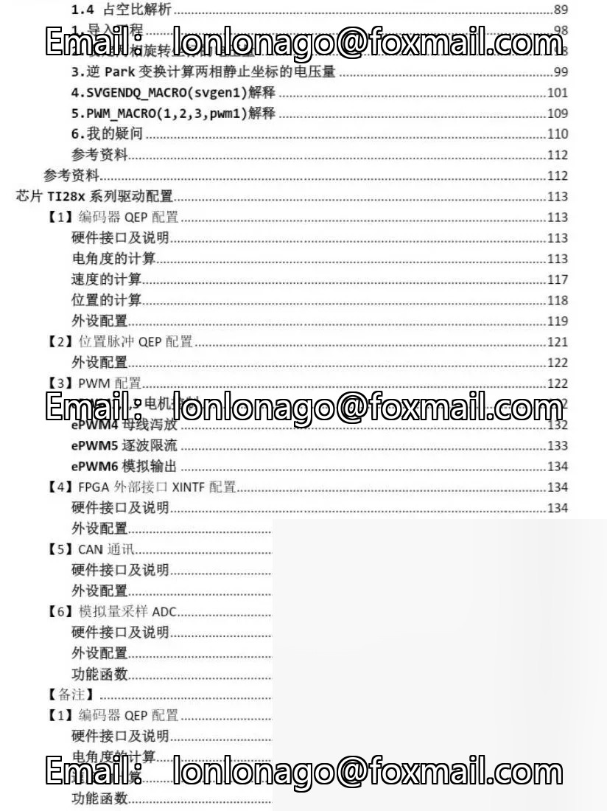

# Software development of motor controller, document explains

## Body

Software development of motor controller, documentation explaining

web-based shipment, can be directly photographed and shipped.

The document explains the software development of an motor controller, covering ePWM modules, FPGA interfaces, CAN communication, PWM functions, motor control, and parameter configurations.

<!-- AI_ENRICHED -->

## Images

## Payment

Here is a pay link on Stripe ( https://buy.stripe.com/3cs8yP7sY87d0vu9AB ). Please contact me lonlonago@foxmail.com after funding $89, and I will send you a complete data files , thank you!

